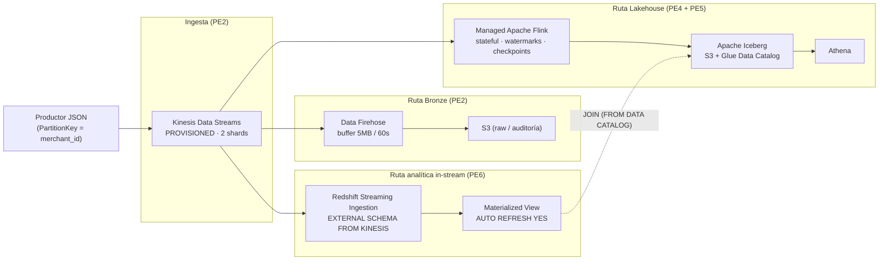

# AWS Real-Time Streaming Data Platform

Plataforma de streaming en tiempo real sobre servicios administrados de AWS, diseñada como proyecto Capstone de ingeniería de datos. Ingesta de eventos JSON, procesamiento stateful con Apache Flink, lakehouse con Apache Iceberg y analítica in-stream con Amazon Redshift, todo provisionado con Terraform.

## Arquitectura



### Rutas de consumo

| Ruta | Origen | Destino | Propósito |
|---|---|---|---|
| **Bronze** | Kinesis → Firehose | S3 raw | Landing histórico y auditoría |
| **Lakehouse** | Kinesis → Flink | Iceberg (S3 + Glue) → Athena | Procesamiento stateful, tablas analíticas |
| **Analítica in-stream** | Kinesis → Redshift Streaming Ingestion | Materialized View → JOIN con Iceberg | Analítica SQL en tiempo real |

> **Nota:** Redshift y Flink son consumidores **paralelos e independientes** de Kinesis. Redshift con ingestión atrasada no implica backpressure directo hacia Flink; comparten los límites por shard del stream.

### Contrato de eventos

```json
{
  "event_id": "evt-20261103-001",
  "event_time": "2026-11-03T20:10:00Z",
  "merchant_id": "m-001",
  "amount": 128.50,
  "currency": "COP",
  "status": "APPROVED"
}
```

## Estructura del repositorio

├── terraform/
│ ├── bootstrap/ # Backend S3 + locking (state remoto)
│ ├── modules/
│ │ ├── networking/ # VPC, subredes privadas, S3 Gateway Endpoint (PE1)
│ │ ├── identity/ # IAM roles y policies (PE1)
│ │ ├── ingestion/ # Kinesis Data Streams, Firehose, KMS (PE2)
│ │ ├── analytics/ # Managed Apache Flink (PE4)
│ │ ├── lakehouse/ # Glue Data Catalog, S3 Iceberg (PE5)
│ │ └── redshift/ # Redshift Streaming Ingestion (PE6)
│ └── environments/
│ └── dev/ # Root module del ambiente de desarrollo
├── flink-app/ # Aplicación Flink stateful (Java + Maven)
├── sql/ # DDL/queries Redshift, Athena y productor
├── scripts/
│ ├── producer/ # Productor JSON para Kinesis
│ └── pe3/ # Scripts PE3 (Kafka/Spark)
├── k8s/ # PE3: Kafka/Spark en Kubernetes (ejercicio aislado)
├── docker/pe3/ # PE3: Docker Compose local
├── tests/ # Pruebas
├── docs/
│ ├── PROJECT_STATUS.md # Estado actualizado del proyecto
│ ├── PLAN_OUTPUT.md # Salida de terraform plan
│ ├── PE2_README.md … PE6_README.md
│ ├── DAAT_Alvarez_Rodriguez_Capstone_RealTime.md
│ ├── adr/ # Registros de decisión arquitectónica
│ └── evidence/ # Evidencias por preentrega (pe2…pe6)
└── .github/workflows/ # CI/CD (solo validación estática)


## Preentregas

| PE | Alcance | Estado | Evidencia AWS | README |
|---|---|---|---|---|
| PE1 | Terraform base, VPC, IAM, backend remoto | `LOCAL_VALIDATED` | ❌ (declarativo) | — |
| PE2 | Kinesis Data Streams + Firehose → S3 | `AWS_VALIDATED` | ✅ | [PE2_README](docs/PE2_README.md) |
| PE3 | Kafka + Kubernetes + Spark (ejercicio aislado) | `LOCAL_VALIDATED` | N/A (local) | [PE3_README](docs/PE3_README.md) |
| PE4 | Apache Flink stateful | `LOCAL_VALIDATED` | ✅ (MiniCluster) | [PE4_README](docs/PE4_README.md) |
| PE5 | Lakehouse Iceberg + Glue + Athena | `AWS_VALIDATED` | ✅ | [PE5_README](docs/PE5_README.md) |
| PE6 | Redshift Streaming Ingestion + MV | `AWS_VALIDATED` | ✅ | [PE6_README](docs/PE6_README.md) |
| DAAT | Documento de Arquitectura y Auditoría Técnica | `LOCAL_VALIDATED` | Parcial | [DAAT](docs/DAAT_Alvarez_Rodriguez_Capstone_RealTime.md) |

## Validación y costo

**Presupuesto real: $0 USD.** La validación AWS se realizó exclusivamente en **AWS Academy Learner Lab** con créditos académicos, desplegando recursos de bajo costo por minutos y eliminándolos de inmediato. Las evidencias (capturas, logs, SQL) están en `docs/evidence/` por preentrega.

| Validación | Alcance |
|---|---|
| `terraform fmt / validate` (CI) | Todas las entregas |
| `mvn clean package` (BUILD SUCCESS + 9 tests) | PE4 (Flink local) |
| Docker/Kind local | PE3 (Kafka + Spark) |
| AWS Academy Lab | PE2 (Kinesis+Firehose), PE5 (Glue+Athena), PE6 (Redshift) |

> El tramo end-to-end completo (Flink→Iceberg en AWS) no se ejecutó por costo; las tablas Iceberg se validaron localmente y vía Athena. Ver limitaciones en el [DAAT](docs/DAAT_Alvarez_Rodriguez_Capstone_RealTime.md).

## Seguridad

- IAM de mínimo privilegio por rol (ingesta, Flink, Redshift)
- Cifrado KMS en Kinesis y S3
- VPC privada con S3 Gateway Endpoint (sin NAT)
- Sin credenciales ni secretos en el repositorio; datos sintéticos únicamente
