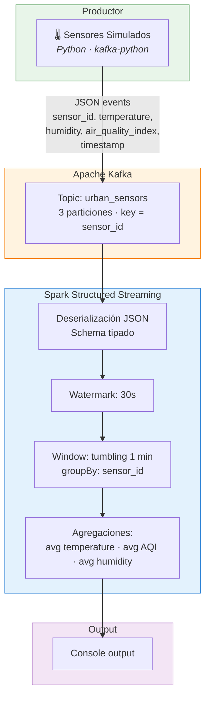

# PE3 — Kafka, Kubernetes y Spark Structured Streaming

## Nota de aislamiento

PE3 es un **ejercicio técnico independiente** de la arquitectura principal AWS
(Kinesis/Flink/Iceberg/Redshift). No comparte infraestructura ni datos con PE1-PE6.

## Arquitectura



## Esquema de datos

| Campo | Tipo | Descripción |
|---|---|---|
| `sensor_id` | string | Identificador del sensor urbano |
| `temperature` | double | Temperatura en °C |
| `humidity` | double | Humedad relativa (%) |
| `air_quality_index` | double | Índice de calidad del aire |
| `timestamp` | string | ISO 8601 UTC |

**Key de Kafka = `sensor_id`**: garantiza que eventos del mismo sensor van a la misma partición.

## Sensores simulados

| ID | Ubicación | Temp base (°C) | AQI base |
|---|---|---|---|
| sensor-norte-001 | Norte | 22.0 | 45 |
| sensor-centro-002 | Centro | 24.0 | 72 |
| sensor-sur-003 | Sur | 21.0 | 55 |
| sensor-oriente-004 | Oriente | 23.0 | 60 |
| sensor-occidente-005 | Occidente | 20.0 | 38 |

## Estructura de archivos

```
k8s/
  namespace.yaml            # Namespace urban-sensors
  zookeeper.yaml            # Zookeeper Deployment + Service
  kafka.yaml                # Kafka Deployment + Service
  producer.yaml             # Productor Deployment
  spark-streaming.yaml      # Spark Streaming Deployment + Service
scripts/pe3/
  producer_sensors.py       # Productor Python con modo --local
  spark_streaming_job.py    # Job Spark Structured Streaming
  requirements_producer.txt # kafka-python
  requirements_spark.txt    # pyspark
docker/pe3/
  docker-compose.yml        # Stack local para pruebas
```

## Ejecución local con Docker Compose

### Prerequisitos

- Docker y Docker Compose instalados
- ~2 GB RAM disponible

### Levantar el stack

```bash
cd docker/pe3

# 1. Iniciar Zookeeper y Kafka
docker compose up -d zookeeper kafka

# 2. Esperar ~30 segundos, luego crear topic
docker compose up kafka-init

# 3. Iniciar productor (200 eventos)
docker compose up -d producer

# 4. Iniciar Spark Streaming (ver output en consola)
docker compose up spark-streaming
```

### Verificar topic

```bash
docker compose exec kafka kafka-topics \
  --bootstrap-server localhost:9092 \
  --describe --topic urban_sensors
```

Salida esperada: `PartitionCount: 3`

### Detener y limpiar

```bash
docker compose down -v
```

## Productor — Modo local (sin Kafka)

```bash
cd scripts/pe3
pip install kafka-python
python producer_sensors.py --local --count 20
```

Imprime eventos JSON a stdout sin necesidad de infraestructura.

## Kubernetes

Los manifiestos en `/k8s/` definen Deployments y Services para:

| Componente | Tipo | Archivo |
|---|---|---|
| Namespace | Namespace | `namespace.yaml` |
| Zookeeper | Deployment + Service | `zookeeper.yaml` |
| Kafka | Deployment + Service | `kafka.yaml` |
| Productor | Deployment | `producer.yaml` |
| Spark | Deployment + Service | `spark-streaming.yaml` |

### Validar manifiestos (sin cluster)

```bash
# kubectl no necesita cluster para validar sintaxis
kubectl apply --dry-run=client -f k8s/
```

### Desplegar en Minikube/Kind (si hay recursos locales)

```bash
kubectl apply -f k8s/namespace.yaml
kubectl apply -f k8s/
kubectl get pods -n urban-sensors
```

## Spark Streaming — Detalle técnico

- **Ventana**: tumbling de 1 minuto (`window("event_time", "1 minute")`)
- **Watermark**: 30 segundos para tolerar eventos tardíos
- **Agrupación**: por `sensor_id` dentro de cada ventana
- **Métricas**: `avg(temperature)`, `avg(air_quality_index)`, `avg(humidity)`
- **Output mode**: `update` (consola) o `append` (parquet)
- **Trigger**: cada 30 segundos (consola) o 1 minuto (parquet)

## Limitaciones académicas

| Aspecto | Estado |
|---|---|
| Docker Compose local | ✅ Verificado — productor + Spark ejecutados |
| Productor modo --local | ✅ Ejecutable sin Kafka |
| Spark job con Kafka | ✅ Verificado — ventanas y promedios en consola |
| Kubernetes en cluster real | `BLOQUEADO` — requiere Minikube/Kind |
| K8s manifiestos válidos | `IMPLEMENTED_UNVERIFIED` — dry-run pendiente |

## Criterios de rúbrica PE3

| Criterio | Peso | Estado |
|---|---|---|
| K8s Deployments/Services en /k8s/ | 30% | `IMPLEMENTED_UNVERIFIED` — manifiestos + ConfigMaps presentes, dry-run pendiente |
| Kafka topic urban_sensors 3 part. + productor | 20% | `LOCAL_VALIDATED` — topic 3 particiones + 200 eventos via Docker |
| Spark ventana 1 min avg temp y AQI por sensor | 25% | `LOCAL_VALIDATED` — promedios por sensor en ventana 1 min verificados |
| README, arquitectura, evidencias | 15% | `LOCAL_VALIDATED` — logs en docs/evidence/pe3/ |
| Calidad repo, seguridad | 10% | `IMPLEMENTED_UNVERIFIED` — ConfigMaps, sin credenciales |

## Imagen Spark

La imagen original `bitnami/spark:3.5.1` fue descontinuada de Docker Hub.
Se utiliza `apache/spark:3.5.3-python3` (imagen oficial Apache) como reemplazo.
