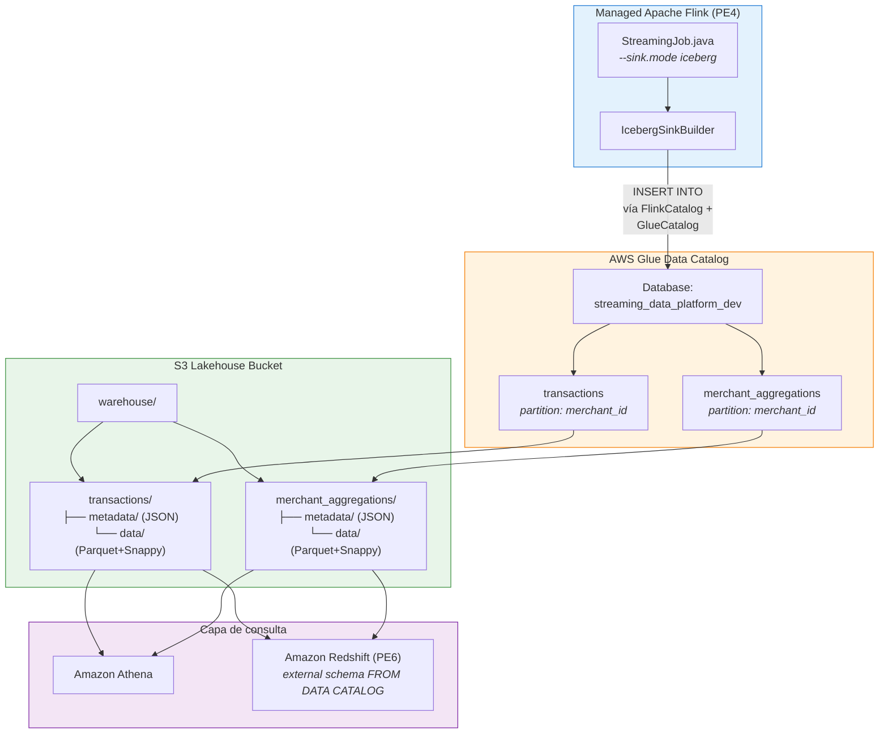

# PE5 — Lakehouse Iceberg con Glue Data Catalog

## Arquitectura



## Contrato de datos

### Tabla `transactions` (eventos individuales)

| Columna | Tipo | Origen |
|---|---|---|
| `event_id` | string | Evento original |
| `event_time` | timestamp | Event Time del productor |
| `merchant_id` | string | Key de partición Iceberg |
| `amount` | double | Monto de transacción |
| `currency` | string | Moneda |
| `status` | string | Estado (completed/pending/failed) |
| `processing_time` | timestamp | Hora de procesamiento Flink |
| `window_start` | timestamp | NULL para eventos individuales |
| `window_end` | timestamp | NULL para eventos individuales |

### Tabla `merchant_aggregations` (ventanas)

| Columna | Tipo | Origen |
|---|---|---|
| `merchant_id` | string | Key de partición Iceberg |
| `window_start` | timestamp | Inicio de ventana |
| `window_end` | timestamp | Fin de ventana |
| `transaction_count` | bigint | Conteo por ventana |
| `total_amount` | double | Suma por ventana |
| `avg_amount` | double | Promedio por ventana |

## Estructura de archivos

terraform/modules/lakehouse/
main.tf # S3 + Glue Database + Tablas Iceberg + IAM
variables.tf # Variables del módulo
outputs.tf # Outputs del módulo
terraform/environments/dev/
main.tf # Instancia module “lakehouse” con variables
flink-app/src/main/java/com/streaming/flink/
StreamingJob.java # --sink.mode print|iceberg
IcebergSinkBuilder.java # Sink Flink → Iceberg vía Glue Catalog
sql/
athena_queries.sql # Consultas de validación Athena
docs/
PE5_README.md # Este documento


## Estrategia de particionado

Ambas tablas usan **`merchant_id`** como partition key con Iceberg hidden partitioning:

| Decisión | Justificación |
|---|---|
| **Key elegida**: `merchant_id` | Las consultas analíticas filtran por merchant (`WHERE merchant_id = 'x'`). Partition pruning en Athena y Redshift Spectrum escanea solo los data files relevantes. |
| **Alternativa evaluada**: `event_time` por hora | Con volumen académico bajo (~cientos de eventos), particionar por hora generaría archivos muy pequeños (small files problem). `merchant_id` ofrece mejor selectividad con este volumen. |
| **Hidden partitioning** | Iceberg v2 maneja la ubicación de archivos transparentemente. No requiere rutas estilo Hive (`merchant_id=x/`). Las consultas SQL con `WHERE merchant_id = 'x'` activan pruning automáticamente. |
| **Producción**: partición compuesta | En un sistema real con alto volumen se usaría `merchant_id` + `days(event_time)` para balancear selectividad y tamaño de archivos. |

### Verificación de partition pruning en Athena

```sql
-- Athena muestra "partition pruning" en EXPLAIN
EXPLAIN
SELECT COUNT(*) FROM streaming_data_platform_dev.transactions
WHERE merchant_id = 'm-001';
-- Espera: ScanFilterProject con pushdown del predicado
```

## Flujo de datos Flink → Iceberg

### Modo de ejecución

`StreamingJob.java` acepta `--sink.mode`:

| Modo | Comportamiento | Uso |
|---|---|---|
| `print` (default) | `.print()` a consola | Pruebas locales (PE4) |
| `iceberg` | `IcebergSinkBuilder` → Glue → S3 | Despliegue AWS (PE5) |

### Ejecución AWS (teórica)

```bash
# En Managed Apache Flink, parámetros de la aplicación:
--stream.name streaming-data-platform-events-dev
--aws.region us-east-1
--sink.mode iceberg
--iceberg.warehouse s3://streaming-data-platform-lakehouse-dev/warehouse
--iceberg.database streaming_data_platform_dev
--iceberg.catalog glue_catalog
```

### Flujo del sink

1. `StreamingJob` detecta `--sink.mode iceberg`
2. Crea `StreamTableEnvironment` sobre el `StreamExecutionEnvironment`
3. `IcebergSinkBuilder.registerCatalog()` ejecuta `CREATE CATALOG` con `GlueCatalog` + `S3FileIO`
4. `writeTransactions()` convierte `DataStream<TransactionEvent>` a Table y ejecuta `INSERT INTO`
5. `writeMerchantAggregations()` hace lo mismo con `DataStream<MerchantAggregation>`
6. Iceberg coordina commits con checkpoints de Flink (cada 60s)

## Consistencia y recuperación

### Commits atómicos Iceberg

Cada escritura produce un **snapshot** atómico: los lectores ven la tabla en un estado consistente (snapshot isolation). Un commit añade un nuevo `metadata.json` que apunta al manifest list actualizado.

### Checkpoint + Iceberg

El sink Iceberg de Flink coordina commits con el mecanismo de checkpoints:

1. Flink acumula escrituras en data files temporales
2. Al completar un checkpoint, el sink ejecuta un commit Iceberg
3. El commit registra los nuevos data files en el metadata
4. Si el checkpoint falla, los archivos temporales se descartan

**Limitación**: la exacta-una-vez entre Flink y el sink Iceberg depende de la implementación del conector y la coordinación con checkpoints. No se garantiza automáticamente sin validación del flujo completo.

### Manejo de concurrencia

Iceberg usa **optimistic concurrency control** para los commits:

| Aspecto | Mecanismo |
|---|---|
| **Modelo** | Optimistic locking sobre metadata pointer en Glue Catalog |
| **Conflicto** | Si dos writers intentan commit simultáneo, uno recibe `CommitFailedException` |
| **Reintentos** | El conector Flink-Iceberg reintenta automáticamente con backoff exponencial (configurable via `commit.retry.num-retries`, default 4) |
| **Resolución** | El retry lee el metadata actualizado, valida que sus cambios no conflictúen, y re-ejecuta el commit |
| **ConcurrentModificationException** | Ocurre en Glue Catalog cuando `UpdateTable` detecta version mismatch. El conector lo captura y reintenta. |

## Evidencias

- `docs/evidence/pe5/Evidencia pe5.pdf` — capturas consola AWS Glue (tablas Iceberg) + consultas Athena (SHOW TABLES, DESCRIBE, SELECT)
- `docs/evidence/pe5/mvn-test-iceberg.txt` — ejecución completa de IcebergLocalTest (BUILD SUCCESS)
- `docs/evidence/pe5/PE5-iceberg-metadata-local.txt` — archivos JSON de metadata Iceberg (commits v1/v2, parquet particionados por merchant_id, manifests)

Validado en AWS Academy Learner Lab (us-east-1), 2026-11-12: catálogo Glue + tablas Iceberg creadas y consultables en Athena. El tramo Flink→Iceberg **en S3/Glue** (escritura real desde Flink) queda como brecha de costo; se validó localmente con HadoopCatalog (mismo formato de metadata Iceberg).
