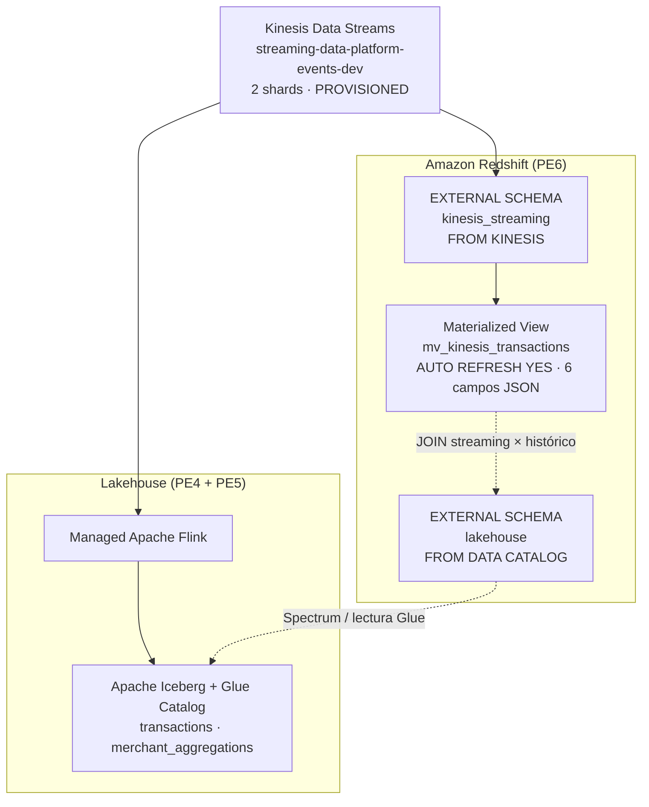

# PE6 — Redshift Streaming Ingestion + Consulta Iceberg

## Arquitectura



## Esquemas externos (distintos)

| Schema | Tipo | Propósito |
|---|---|---|
| `kinesis_streaming` | `FROM KINESIS` | Streaming Ingestion directa |
| `lakehouse` | `FROM DATA CATALOG` | Consulta tablas Iceberg (Spectrum) |

**Nota crítica:** son mecanismos completamente distintos. `FROM KINESIS` lee el stream en tiempo real; `FROM DATA CATALOG` consulta datos históricos en S3 vía Glue. No se debe usar `FROM DATA CATALOG` para streaming ingestion.

## Materialized View

```sql
CREATE MATERIALIZED VIEW mv_kinesis_transactions
AUTO REFRESH YES
AS
SELECT
    approximate_arrival_timestamp, partition_key, shard_id, sequence_number,
    JSON_EXTRACT_PATH_TEXT(from_varbyte(kinesis_data, 'utf-8'), 'event_id')     AS event_id,
    JSON_EXTRACT_PATH_TEXT(from_varbyte(kinesis_data, 'utf-8'), 'event_time')   AS event_time,
    JSON_EXTRACT_PATH_TEXT(from_varbyte(kinesis_data, 'utf-8'), 'merchant_id')  AS merchant_id,
    CAST(JSON_EXTRACT_PATH_TEXT(from_varbyte(kinesis_data, 'utf-8'), 'amount') AS DECIMAL(18,2)) AS amount,
    JSON_EXTRACT_PATH_TEXT(from_varbyte(kinesis_data, 'utf-8'), 'currency')     AS currency,
    JSON_EXTRACT_PATH_TEXT(from_varbyte(kinesis_data, 'utf-8'), 'status')       AS status
FROM kinesis_streaming."streaming-data-platform-events-dev";
```

- **AUTO REFRESH YES**: Redshift actualiza automáticamente la MV
- **6 campos JSON** (rúbrica exige ≥3): event_id, event_time, merchant_id, amount, currency, status
- **event_time como TEXTO**: el `CAST` a TIMESTAMP es función *mutable* y Redshift no permite AUTO REFRESH sobre MVs con funciones mutables. El cast se hace en consultas downstream.

## Estructura de archivos

terraform/modules/redshift/
main.tf # Namespace/Workgroup/Cluster + SG + IAM (Kinesis+Glue+S3+KMS)
variables.tf · outputs.tf
sql/
01_streaming_schema.sql # External schema FROM KINESIS
02_materialized_view.sql # MV con 6 campos JSON + AUTO REFRESH
03_external_schema_glue.sql # External schema FROM DATA CATALOG
04_queries_and_joins.sql # Consultas + JOIN streaming × Iceberg
05_refresh_and_monitoring.sql # REFRESH, métricas, latencia
pe6_producer.py # Productor JSON para Kinesis
docs/
PE6_README.md # Este archivo
evidence/pe6/ # Evidencia AWS (PDF + capturas)


## SQL — Orden de ejecución

1. `01_streaming_schema.sql` — schema `kinesis_streaming` FROM KINESIS
2. `02_materialized_view.sql` — MV base (6 campos) + AUTO REFRESH
3. `03_external_schema_glue.sql` — schema `lakehouse` FROM DATA CATALOG
4. `04_queries_and_joins.sql` — consultas + JOINs
5. `05_refresh_and_monitoring.sql` — REFRESH manual + métricas
6. `06_analytics_role.sql` — Rol de analítica con acceso restringido (seguridad)

## JOIN: Streaming × Iceberg

```sql
SELECT
    mv.event_id, mv.merchant_id, mv.amount,
    agg.avg_amount AS merchant_window_avg,
    CASE
        WHEN mv.amount > agg.avg_amount * 2   THEN 'HIGH'
        WHEN mv.amount < agg.avg_amount * 0.5 THEN 'LOW'
        ELSE 'NORMAL'
    END AS amount_category
FROM mv_kinesis_transactions mv
LEFT JOIN lakehouse.merchant_aggregations agg
    ON mv.merchant_id = agg.merchant_id
   AND CAST(mv.event_time AS TIMESTAMP) >= agg.window_start
   AND CAST(mv.event_time AS TIMESTAMP) <  agg.window_end;
```

Permite detectar anomalías comparando cada transacción con el promedio histórico de su merchant en la ventana correspondiente.

## Refresh y latencia

- **AUTO REFRESH YES**: Redshift gestiona la frecuencia de refresh
- **REFRESH manual**: `REFRESH MATERIALIZED VIEW mv_kinesis_transactions`
- **Freshness**: `DATEDIFF(second, MAX(arrival), GETDATE())`
- **Latencia E2E**: `DATEDIFF(ms, CAST(event_time AS TIMESTAMP), arrival_timestamp)`
- Monitoreo: `STV_MV_INFO`, `SYS_MV_REFRESH_HISTORY`

**Nota:** AUTO REFRESH no es instantáneo. Redshift **no transmite backpressure directamente a Flink ni a Kinesis** — son consumidores independientes que comparten los mismos shards.

## Terraform — Recursos declarados

| Recurso | Tipo | Propósito |
|---|---|---|
| Namespace/Cluster | `aws_redshiftserverless_namespace` / `aws_redshift_cluster` | Warehouse |
| Workgroup | `aws_redshiftserverless_workgroup` | Compute (serverless) |
| Security Group | `aws_security_group` | Puerto 5439 |
| IAM Kinesis/Glue/S3/KMS | `aws_iam_role_policy` | Streaming + Spectrum + lectura + descifrado |

## IAM — Mínimo privilegio

- **Kinesis**: solo lectura (`GetRecords`, `GetShardIterator`, `DescribeStream`) + consumer management
- **Glue**: solo lectura del catálogo (`GetDatabase`, `GetTable`, `GetPartition`)
- **S3**: solo lectura del lakehouse (`GetObject`, `ListBucket`)
- **KMS**: solo `Decrypt` y `GenerateDataKey`
- Sin permisos de escritura en recursos externos

## Estado de validación (AWS Academy, 2026-11-12)

| Aspecto | Estado |
|---|---|
| Terraform HCL válido | ✅ `terraform validate` en CI |
| SQL ejecutado en Redshift real | ✅ ra3.large (Serverless bloqueado en Academy) |
| Esquema Kinesis y Glue distintos | ✅ `kinesis_streaming` + `lakehouse` |
| MV con ≥3 campos | ✅ 6 campos JSON, COUNT=50 |
| AUTO REFRESH configurado | ✅ `autorefresh=t` en STV_MV_INFO |
| JOIN streaming × Iceberg | ✅ Ejecutado |
| Métricas de latencia/freshness | ✅ Medidas |
| Tablas Iceberg con datos (Flink en AWS) | ⚠️ Vacías (Flink no ejecutado en AWS) |

## Criterios de rúbrica PE6

| Criterio | Peso | Estado |
|---|---|---|
| Streaming schema FROM KINESIS + MV ≥3 campos | 35% | `AWS_VALIDATED` |
| External schema FROM DATA CATALOG + JOIN | 25% | `AWS_VALIDATED` |
| REFRESH / AUTO REFRESH + métricas latencia | 15% | `AWS_VALIDATED` |
| IAM mínimo privilegio | 15% | `LOCAL_VALIDATED` (Terraform repo) |
| SQL, documentación y evidencia | 10% | `AWS_VALIDATED` (13 queries + PDF) |
